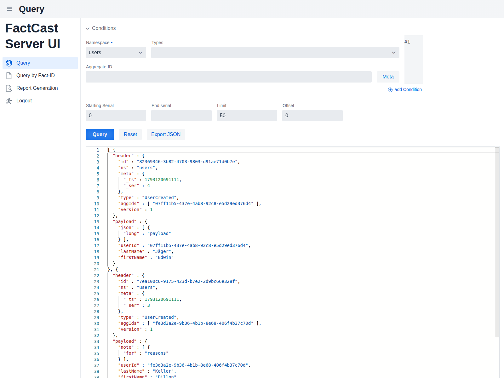
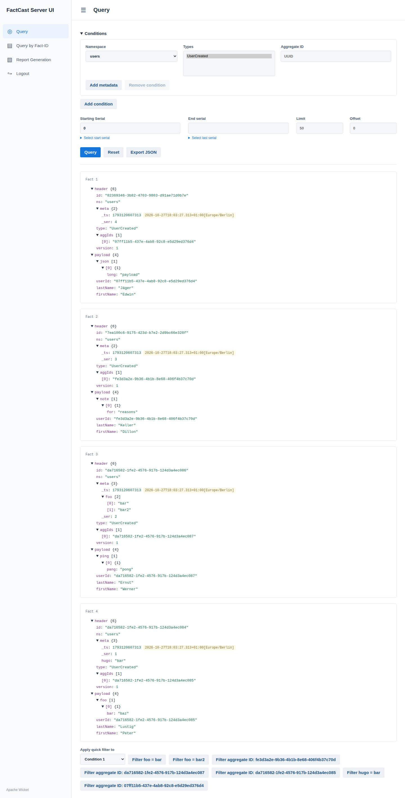
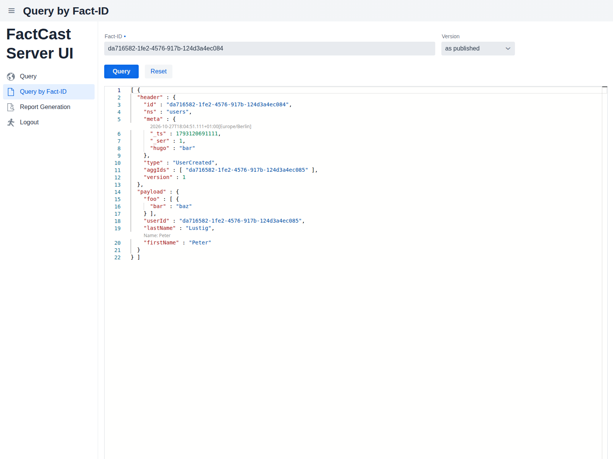
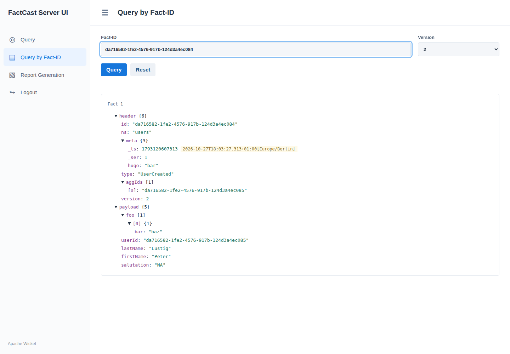
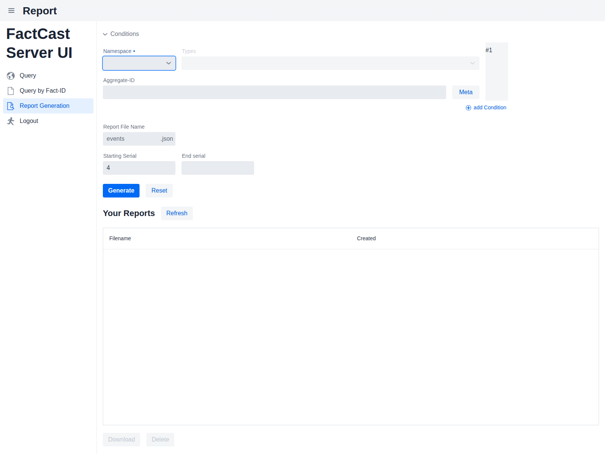
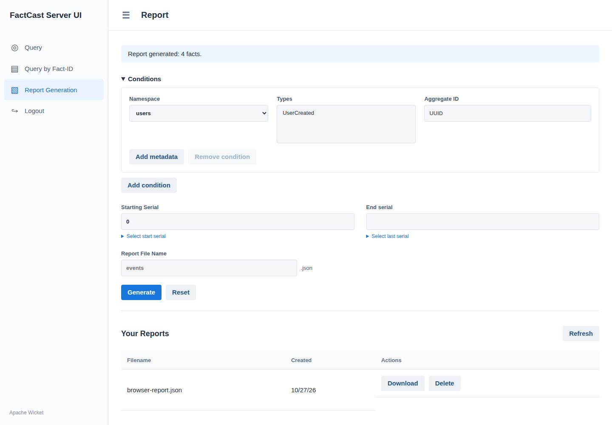

# FactCast Server UI — Apache Wicket

An alternative to `factcast-server-ui` (Vaadin), using Java 21, Apache Wicket 10,
Spring Boot, and Spring Security. Query, Query by Fact-ID, and Report Generation
retain the existing navigation drawer, page header, filter forms, and result area.
HTML, CSS, and JavaScript are served locally; this module needs no Node/Vaadin build.

## Layout comparison

Captured against the same seeded PostgreSQL example. The Wicket query tree and
Vaadin Monaco viewer use different rendering controls while retaining the same
navigation, filters, and backend operations.

| Screen | Vaadin | Wicket |
| --- | --- | --- |
| Query |  |  |
| Fact-ID |  |  |
| Reports |  |  |

## Integration

Add `org.factcast:factcast-server-ui-wicket` alongside
`org.factcast:factcast-spring-boot-autoconfigure` and your existing FactStore backend.
Use the FactCast BOM for versions. Remove `factcast-server-ui` from the application's
dependencies: loading both UI implementations deliberately fails at startup.

The existing FactCast accounts, namespace permissions, JSON plugins, report formats,
and `factcast.ui.report.store.path` / `factcast.ui.report.store.s3` settings apply.
For S3 reports, add `factcast-server-ui-s3-reportstore`; it no longer pulls in Vaadin.
A custom `ReportStore` bean also works. Configure either a filesystem path or a
report-store implementation before starting the UI.

| Route | Functionality |
| --- | --- |
| `/` or `/ui/full` | Conditions for namespace/types, aggregate ID, metadata, serial/date helpers, limit/offset; JSON results and export |
| `/ui/id` | Fact UUID lookup, published/transformed version selection, JSON results |
| `/ui/report` | Generate, list, refresh, download, and delete reports for the authenticated account |
| `/login` | FactCast username/password login; logout is a CSRF-protected POST |

Query parameters use the existing `state` JSON representation, so query links can
be shared between deployments. JSON results show expandable header/payload trees,
plugin annotations and tooltips, and quick-filter controls. The Wicket renderer
uses native HTML details rather than the Vaadin Monaco editor.

For production, select Wicket deployment mode with `-Dwicket.configuration=deployment`.

## Local example

The example starts a PostgreSQL Testcontainer, loads the existing sample schema
registry, and publishes four `UserCreated` facts. Docker must be available.

From the repository root:

```sh
mvnd -pl factcast-server-ui-wicket -am -Dmaven.compiler.proc=full -DskipTests install
mvnd -f factcast-server-ui-wicket/pom.xml -Dmaven.compiler.proc=full -Dexec.classpathScope=test -Dexec.mainClass=org.factcast.server.ui.wicket.example.ExampleWicketServer test-compile exec:java
```

Open <http://localhost:8080>, use any username and password `security_disabled`,
select namespace `users`, set Starting Serial to `0`, and click Query. Example
reports are written under `target/wicket-reports` relative to the launch directory.

Example Fact-ID: `da716582-1fe2-4576-917b-124d3a4ec084`.

## Validation and screenshots

```sh
mvnd -pl factcast-server-ui-wicket -am -Dmaven.compiler.proc=full -Dtest=WicketWorkflowTest,WicketServerTest -Dsurefire.failIfNoSpecifiedTests=false test >  /tmp/codex-test.log 2>&1 || tail -100 /tmp/codex-test.log
mvnd -pl factcast-server-ui-wicket -am -Dmaven.compiler.proc=full -Dui -Dtest=WicketWorkflowTest,WicketServerTest -Dit.test=WicketBrowserIntTest -Dsurefire.failIfNoSpecifiedTests=false -Dfailsafe.failIfNoSpecifiedTests=false verify >  /tmp/codex-test.log 2>&1 || tail -100 /tmp/codex-test.log
```

The browser test requires Playwright Chromium. To use an installed Chromium instead,
add `-Dui.browser=/absolute/path/to/chrome`. It verifies login, Ajax namespace/type
selection, querying, export, restored query links, transformations, report generation,
download/deletion, logout, and browser JavaScript errors. Screenshots are written to
`factcast-server-ui-wicket/target/ui-screenshots/wicket-{login,query,id,reports}.png`.

The shared backend tests live in `factcast-server-ui-common`. Existing Vaadin tests
remain in `factcast-server-ui`.
